# Guía de uso de Toca — ¿Qué toca hoy?

Toca te ayuda a decidir qué cocinar teniendo en cuenta lo que ya has comido esta semana:
- publicas recetas y descubres las del resto de usuarios;
- apuntas las que comes;
- la aplicación te recomienda las que encajan con las raciones semanales de cada grupo de alimentos.

Esta guía explica cómo usarla. Al final hay un apartado para los administradores.

> Las capturas son de la aplicación con los datos de demostración (usuarios `lucia`, `marcos` y `carmen`).

## Índice

1. [Crear una cuenta e iniciar sesión](#1-crear-una-cuenta-e-iniciar-sesión)
2. [La portada](#2-la-portada)
3. [Buscar recetas](#3-buscar-recetas)
4. [Ver una receta](#4-ver-una-receta)
5. [Crear y editar tus recetas](#5-crear-y-editar-tus-recetas)
6. [Mis recetas](#6-mis-recetas)
7. [Ingredientes](#7-ingredientes)
8. [¿Qué toca hoy?](#8-qué-toca-hoy)
9. [Mi alimentación](#9-mi-alimentación)
10. [El histórico de lo que has comido](#10-el-histórico-de-lo-que-has-comido)
11. [El planificador semanal](#11-el-planificador-semanal)
12. [Mi perfil](#12-mi-perfil)
13. [Toca en el móvil y sin conexión](#13-toca-en-el-móvil-y-sin-conexión)
14. [Administración](#14-administración)
15. [Preguntas frecuentes](#15-preguntas-frecuentes)

---

## 1. Crear una cuenta e iniciar sesión

**Registrarse.** En la pantalla de inicio, pulsa **Registrarse** y rellena:
- **Nombre de usuario:** de 3 a 30 caracteres. Admite letras sin tilde, números, punto, guion y guion bajo. No se puede cambiar después.
- **Nombre, primer apellido** y, si quieres, **segundo apellido**.
- **Email:** no puede usarlo otra cuenta. Te llegará un correo de bienvenida con un enlace para **confirmar tu email**.
- **Contraseña:** de 8 a 72 caracteres, escrita dos veces. La ñ, las letras con tilde y los emojis cuentan como más de un carácter: con muchos, caben menos de 72.

El botón **Registrarse** se activa cuando todos los datos son correctos. Si el nombre de usuario o el email ya están en uso, el aviso aparece junto a ese campo.

**Confirmar el email.** Abre el enlace del correo de bienvenida: sirve una vez y caduca en 24 horas. Mientras no lo confirmes puedes usar Toca con normalidad, salvo crear ingredientes nuevos, pero un aviso bajo la cabecera te lo recuerda. Si no te ha llegado o ha caducado, pulsa **Enviar el enlace** en ese aviso o en **Mi perfil**; si escribiste mal el email, corrígelo en **Mi perfil**. Con el email confirmado sabemos que los avisos y la recuperación de la contraseña llegan a tu buzón.

**Iniciar sesión.** Escribe tu nombre de usuario **o** tu email y la contraseña. El icono del ojo muestra la contraseña mientras la escribes. La sesión dura varias horas (8, salvo que se haya configurado otro valor); después tendrás que volver a entrar. Tras muchas contraseñas incorrectas seguidas con tu usuario (aunque no las hayas escrito tú), no se podrá entrar con él durante unos minutos; si no quieres esperar, pide un enlace con **He olvidado la contraseña**: al elegir una nueva, puedes entrar enseguida.

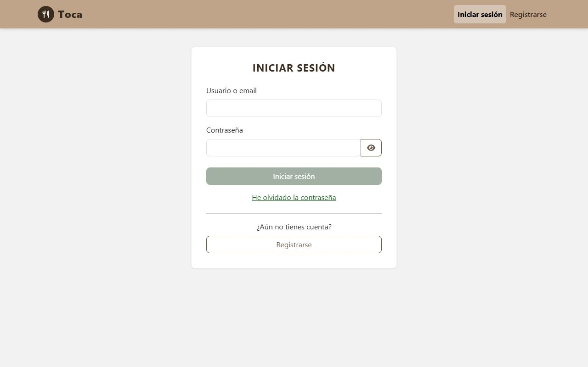

**Entrar con Google.** Si la aplicación lo tiene configurado, bajo **Iniciar sesión** aparece **Entrar con Google**. Al pulsarlo, Google te pide que elijas tu cuenta y que aceptes compartir tu nombre y tu email con Toca. Después:
- si ya tienes una cuenta en Toca con el mismo email y lo has confirmado, se vinculan directamente y entras. Si no lo has confirmado, la primera vez te pide **la contraseña de esa cuenta** para vincularlas. Desde entonces entras con Google directamente, y también puedes seguir usando tu contraseña. Si no la recuerdas, pide un enlace con **He olvidado la contraseña**, elige una nueva y vuelve a entrar con Google. Te llegará un correo avisando de la vinculación;
- si no, eliges tu **nombre de usuario** y revisas tu nombre y tus apellidos, que vienen ya rellenos con los de Google. El email es el de Google; luego puedes cambiarlo en **Mi perfil**. Tienes 15 minutos para terminar;
- si Google no ha verificado tu email, o tu cuenta de Toca con ese email ya está vinculada con otra cuenta de Google, no entras y la pantalla de inicio de sesión te lo explica.

Si lo intentas muchas veces seguidas (contraseñas, registros, correos de recuperación), la aplicación te pide que esperes unos minutos.

**He olvidado la contraseña.**
1. Pulsa ese enlace y escribe tu email.
2. Si tiene una cuenta, recibirás un correo con un enlace para elegir una contraseña nueva. El enlace sirve **una sola vez** y caduca en **1 hora**.
3. Por seguridad, la aplicación muestra el mismo mensaje exista o no el email.

Para salir, abre el menú **Bienvenido, {tu nombre}** (arriba a la derecha) y pulsa **Cerrar sesión**.

## 2. La portada

La portada tiene:
- **Un buscador.** Escribe al menos dos letras del título para ver sugerencias: al elegir una, se abre la receta. Si pulsas Intro sin elegir, verás todas las recetas cuyo título contiene ese texto.
- **Recetas mejor valoradas.** Las tres con mejor nota media (apartado 4). Una receta con pocas valoraciones necesita notas altas para subir: una sola de 5 no adelanta a muchas de 4.
- **Últimas recetas añadidas.** Las tres más recientes.

La barra superior lleva a todas las secciones; el logotipo **Toca** siempre vuelve a la portada.

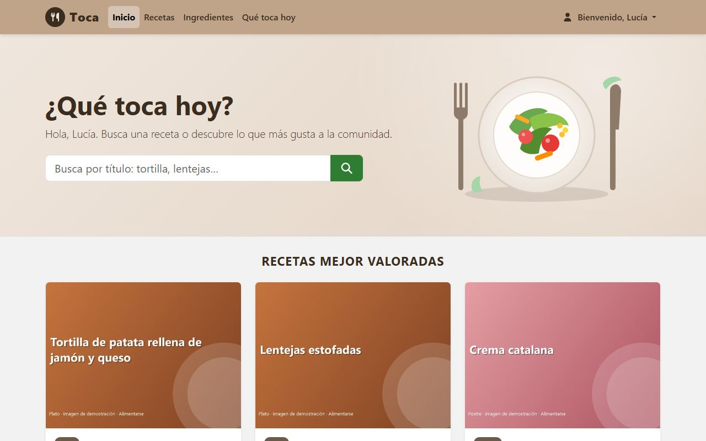

## 3. Buscar recetas

En **Recetas** están todas las recetas publicadas, de la más reciente a la más antigua, nueve por página. Pulsa **Filtros** para desplegarlos:

| Filtro | Qué hace |
|---|---|
| Título | Contiene el texto. No distingue mayúsculas ni tildes |
| Tipo | Plato, Entrante, Postre, Bebida, Desayuno o Salsa |
| Autor | Su nombre de usuario contiene el texto |
| Dificultad | Fácil, Media o Difícil |
| Comensales (mínimo) | Recetas para al menos ese número de personas |
| Tiempo máximo | Recetas que se preparan en esos minutos como mucho |
| Ingredientes | Escribe y elige uno o varios: la receta debe llevarlos **todos** |

Pulsa **Filtrar** para aplicarlos o **Restablecer** para quitarlos. Si abres una receta y vuelves con **Volver**, el listado sigue con los mismos filtros y en la misma página.

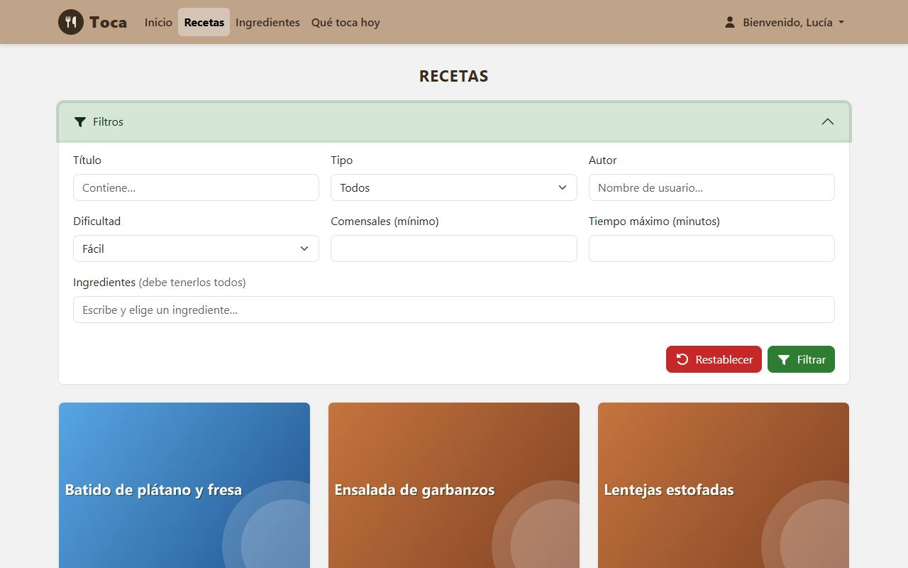

Cada tarjeta muestra:
- **Datos:** el tipo, el autor, el tiempo, los comensales y la dificultad, con un termómetro verde, ámbar o rojo.
- **«Me gusta»:** el corazón y cuántos tiene. Pulsa el corazón para darlo o quitarlo.

## 4. Ver una receta

Al abrir una receta verás:
- sus fotos, el título, el autor y la fecha. Si tiene varias fotos, pasa de una a otra con las flechas que hay sobre la foto (o con las teclas de flecha) o pulsando una miniatura. Si tiene vídeo, **Ver el vídeo** lo abre en YouTube o Vimeo, en otra pestaña;
- las **instrucciones**;
- a un lado (en el móvil, antes de las instrucciones):
  - **Ingredientes**, cada uno con su cantidad;
  - **Información nutricional**: una estimación por ración y de la receta entera (más abajo);
  - **Contiene**: los grupos de alimentos de esos ingredientes;
  - **Recomendado**: cuántas veces a la semana se puede comer como máximo, según el grupo más limitado que contiene;
  - **Tiempo, comensales y dificultad**;
  - **¿La has comido?**: la fecha y la hora (por defecto, ahora) y el botón **Añadir a consumidos**, que la apunta en tu alimentación. No se admiten fechas futuras, y se pueden apuntar como mucho 50 consumos al día. Encima del botón, **Si la comes ahora** te dice cómo quedarían las raciones de los grupos con límite, y te avisa si llegarías al máximo o te pasarías;
  - **Me gusta**.
- debajo de las instrucciones, sus **valoraciones** (más abajo).

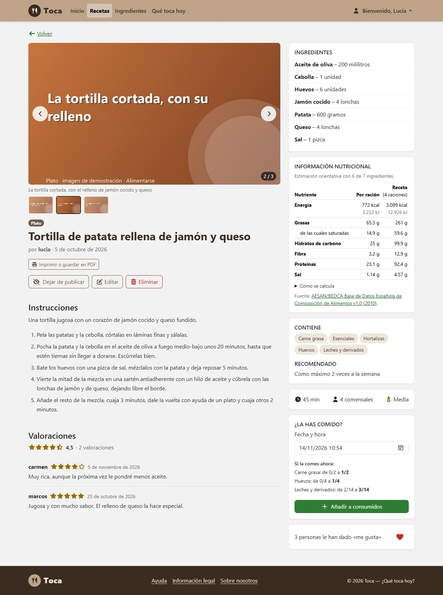

Si la receta es tuya, verás además los botones **Publicar** (o **Dejar de publicar**), **Editar** y **Eliminar**.

### Valoraciones

Cada receta muestra su **nota media** con estrellas, de 1 a 5, y cuántas valoraciones tiene. También aparece en las tarjetas de los listados.

- Para **valorar una receta**, elige las estrellas en **Valora esta receta**, escribe un comentario si quieres y pulsa **Guardar valoración**. El comentario se publica con tu nombre de usuario.
- Con el teclado, las flechas cambian la nota, como en cualquier grupo de opciones.
- Solo hay una valoración tuya por receta: si la cambias, sustituye a la anterior. **Borrar mi valoración** la quita.
- No puedes valorar tus propias recetas, ni una que no está publicada.
- Debajo están las valoraciones de todos, de la más reciente a la más antigua. **Ver más valoraciones** carga las siguientes.
- La valoración es tu opinión, para todos; el **me gusta** es para guardarla en **Recetas que me gustan**. Puedes usar los dos.

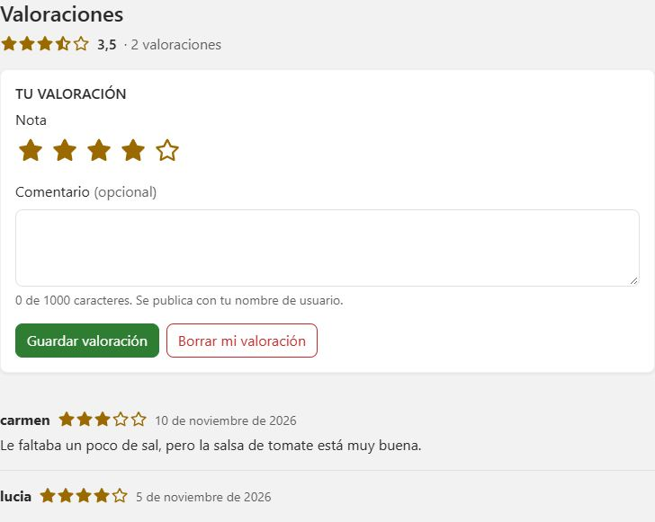

**Imprimir o guardar en PDF**, bajo el título, abre el diálogo de impresión del navegador. Allí puedes elegir la impresora o **Guardar como PDF**. Se imprime solo la receta: la foto, los ingredientes, los grupos que contiene, el tiempo y las instrucciones, sin menú ni botones.

### Información nutricional

Bajo los ingredientes, **Información nutricional** estima la energía (en kcal y kJ), las grasas, las grasas saturadas, los hidratos de carbono, la fibra, las proteínas y la sal de **una ración** y de **la receta entera**.

- Se calcula con la **Base de Datos Española de Composición de Alimentos (BEDCA)**: para cada ingrediente, los valores por 100 g de un alimento parecido («Harina de trigo», «Huevo de gallina fresco»).
- Solo cuentan los ingredientes cuya cantidad se puede pasar a gramos: en gramos o kilos, en mililitros o litros (un mililitro cuenta como un gramo), en cucharadas (15 g) o cucharaditas (5 g), y en unidades, dientes, lonchas, latas… de los ingredientes que tienen un peso para esa pieza (un huevo, 50 g). El número puede ir con letras: «una lata», «media», «medio kilo». «Al gusto» o «1 pizca» no cuentan.
- Cuenta todo el aceite de la receta: en los fritos, como no se absorbe entero, la energía y las grasas salen más altas de lo que son.
- **Cómo se calcula** muestra qué cuenta de cada ingrediente y por qué no cuentan los demás. Si quieres que una receta tuya tenga una estimación más completa, escribe las cantidades en gramos.
- Es una **estimación orientativa**, no una etiqueta nutricional ni un consejo médico.

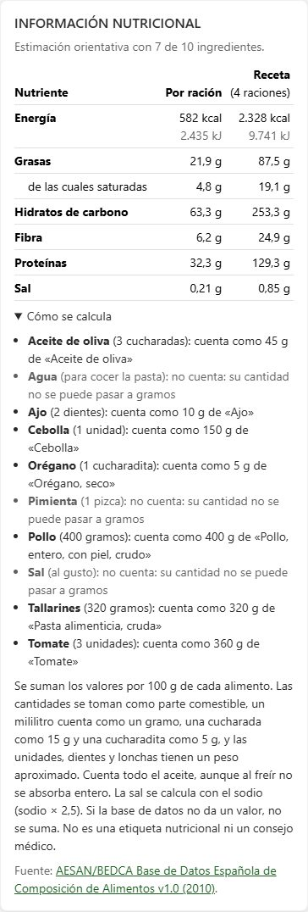

Si la administración ha **ocultado** una receta tuya, la verás marcada como **Oculta por la administración**, con el motivo. Solo la ves tú (y los administradores): puedes editarla, pero no publicarla mientras siga oculta. Si crees que ya está corregida, ponte en contacto con la administración.

## 5. Crear y editar tus recetas

Ve a **Mis recetas** y pulsa **Nueva receta** (puedes tener hasta 500). Para editar una, pulsa **Editar** en su tarjeta o en su detalle.

1. **Título.**
2. **Ingredientes.** Escribe el nombre, elige una sugerencia, indica la cantidad («200 gramos», «1 cucharada»…) y pulsa **Añadir**. Cada ingrediente aparece como una etiqueta que puedes quitar con la ×. Una receta admite hasta 50.
   - Si un ingrediente no existe, pulsa **Crear ingrediente**, escribe su nombre, elige su grupo y guárdalo: queda elegido para que solo añadas la cantidad.
3. **Instrucciones.** El editor admite negrita, cursiva, subrayado, subtítulos, listas (también numeradas, para los pasos), citas y enlaces.
4. **Tipo, tiempo** (en minutos), **comensales** y **dificultad.**
5. **Fotos** (opcionales): hasta 6, en JPEG, PNG o WebP de hasta 5 MB cada una. Puedes elegir varias a la vez.
   - La **primera es la principal**: es la que sale en las tarjetas. Con **Subir** y **Bajar** (las flechas) cambias el orden, y con la papelera quitas una.
   - Escribe una **descripción** de cada foto («La tortilla cortada»): es lo que leen quienes no la ven.
   - La aplicación reduce las fotos muy grandes y les quita los datos ocultos, como el lugar donde se hicieron. Al editar, las que dejas se conservan y las que quitas se borran al guardar.
6. **Vídeo** (opcional): el enlace a un vídeo de la receta en YouTube o Vimeo (que empiece por `https://`). En la receta aparece como un enlace.

**Guardar** se activa cuando la receta está completa. Si sales con cambios sin guardar, la aplicación te pide confirmación.

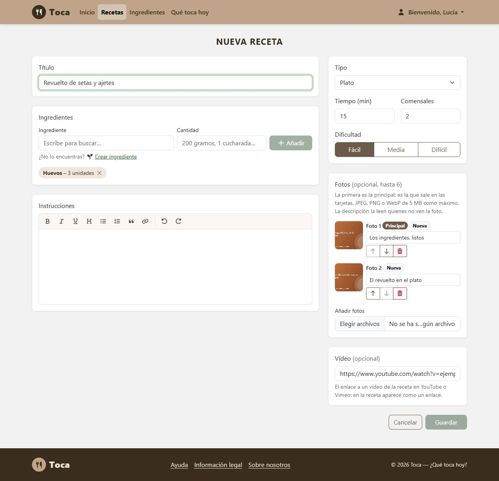

**Publicar.** Una receta nueva se guarda **sin publicar**: solo la ves tú. Cuando esté lista, pulsa **Publicar** para que la vea todo el mundo. Puedes dejar de publicarla cuando quieras. Solo las recetas publicadas pueden recibir «me gusta».

## 6. Mis recetas

Aquí están todas tus recetas, publicadas o no, con los mismos filtros que el listado general:
- cada tarjeta indica si está **Publicada** o **No publicada**;
- el botón del ojo publica la receta o deja de publicarla;
- el del lápiz la edita;
- el de la papelera la elimina, después de pedirte confirmación.

### Recetas que me gustan

En **Bienvenido, {tu nombre} → Recetas que me gustan** están las recetas publicadas a las que has dado «me gusta», de la última que te gustó a la primera. Tienen los mismos filtros que el listado general. Si quitas el corazón de una, sale de la lista.

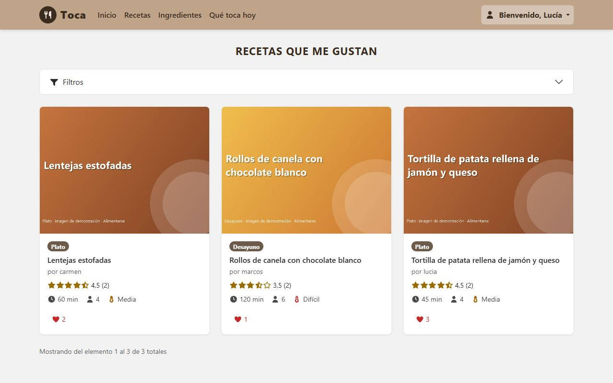

**Eliminar una receta** no se puede deshacer. Si alguien ya la había comido, la receta sigue en su histórico, marcada como **Eliminada** y sin foto, y sigue contando en sus raciones de la semana; pero nadie, ni tú, puede volver a abrirla.

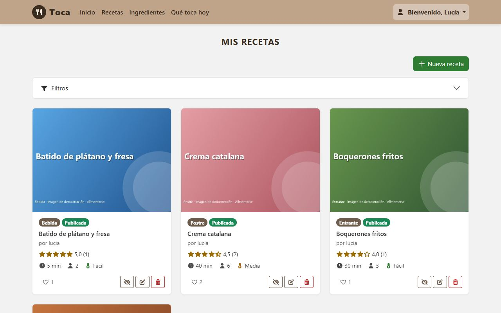

## 7. Ingredientes

En **Ingredientes** está el catálogo completo, dieciséis por página. Puedes:
- **filtrarlo** por nombre y grupo;
- ver junto a cada ingrediente su grupo y sus raciones semanales recomendadas, o «sin límite», y el alimento de BEDCA con el que se calcula su información nutricional (o «Sin datos nutricionales»);
- **crear un ingrediente** con **Nuevo ingrediente**: nombre (no puede repetirse) y grupo de alimentos. Para crear ingredientes hace falta tener el email confirmado, y se pueden crear hasta 30 al día.

Solo los administradores pueden editar un ingrediente que ya existe.

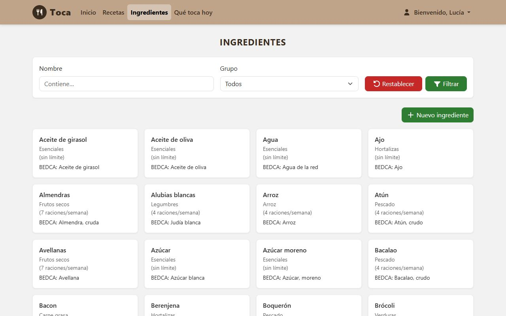

## 8. ¿Qué toca hoy?

Es la sección de recomendaciones. Cada grupo de alimentos tiene un **máximo de raciones por semana**:

| Grupo | Raciones a la semana | Grupo | Raciones a la semana |
|---|---|---|---|
| Carne | 3 | Leches y derivados | 14 |
| Carne grasa | 2 | Frutos secos | 7 |
| Pescado | 4 | Dulces | 1 |
| Huevos | 4 | Fruta | sin límite |
| Legumbres | 4 | Verduras | sin límite |
| Pasta | 4 | Hortalizas | sin límite |
| Arroz | 4 | Esenciales y Especias | sin límite |

Toca cuenta cuántas recetas de cada grupo has comido en los **últimos 7 días**. Si un grupo ha llegado a su máximo, ya no te recomienda recetas que lo lleven. El aviso de arriba te dice qué grupos has completado.

A medida que pasan los días, los consumos antiguos salen de la ventana de 7 días y esos grupos vuelven a estar disponibles. Puedes usar los mismos filtros que en Recetas.

Para que varíes, salen primero las recetas de los grupos que **menos has comido esta semana**: las que llevan un grupo ya empezado van después, y las que llevan uno cerca de su máximo, al final. Cada tarjeta explica por qué se recomienda:
- **Sin consumir esta semana: Legumbres**: aún no has comido nada de ese grupo;
- **Te quedan raciones de Carne (2/3)**: ya has empezado ese grupo, pero aún tienes margen;
- **Sin límite semanal: Fruta**: solo lleva grupos que no tienen máximo.

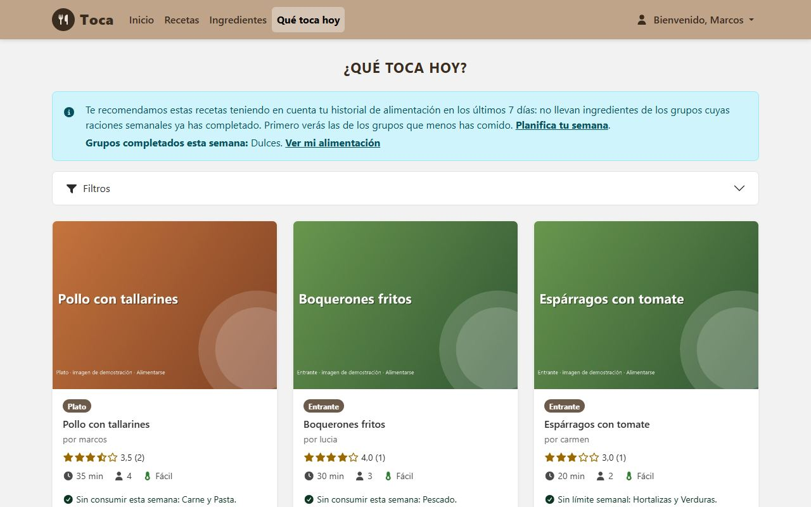

## 9. Mi alimentación

Resume lo que has comido:
- **Últimas recetas consumidas:** las tres más recientes, con la fecha y la hora. **Ver histórico completo** lleva a la lista entera.
- **Recetas más consumidas:** las tres que más veces has comido.
- **Ingredientes más usados:** los cuatro que más aparecen en lo que comes. No se cuentan los básicos (sal, aceite, agua, especias…), que están en casi todas las recetas.
- **Ingredientes en los últimos 7 días:** un círculo por cada grupo que has comido esta semana, con las raciones tomadas frente a las recomendadas:
  - **verde:** por debajo del 75 % del máximo, o grupo sin límite;
  - **ámbar:** entre el 75 % y el máximo, sin llegar;
  - **rojo:** has llegado al máximo; esos alimentos no se te recomiendan hasta que pasen unos días.
- **Nutrientes en los últimos 7 días:** la energía, las grasas, los hidratos, la fibra, las proteínas y la sal de lo que has registrado, con la información nutricional de cada receta (cada consumo cuenta como una ración):
  - **Al día:** la media de los 7 días, aunque algún día no registraras nada;
  - **% IR:** qué parte es de la ingesta de referencia de un adulto medio, la que aparece en las etiquetas de los alimentos (2.000 kcal al día). Las necesidades de cada persona son distintas;
  - **En 7 días:** el total.

  Solo cuenta lo que registras en Toca, y solo las recetas con información nutricional: encima de la tabla verás cuántos de tus consumos tienen datos. Es una estimación orientativa, no un consejo médico.

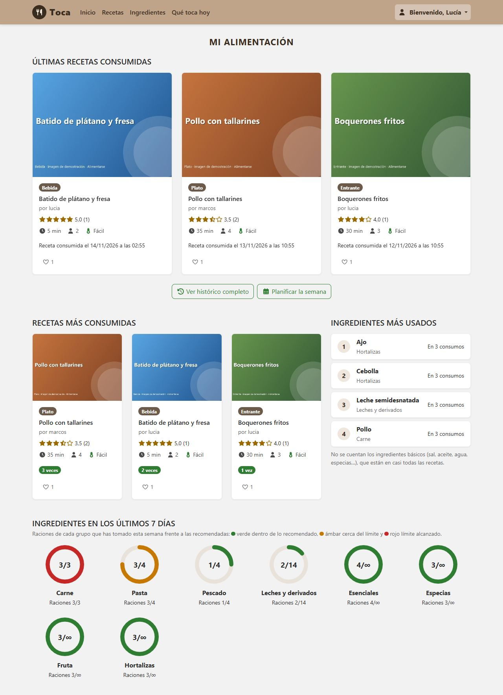

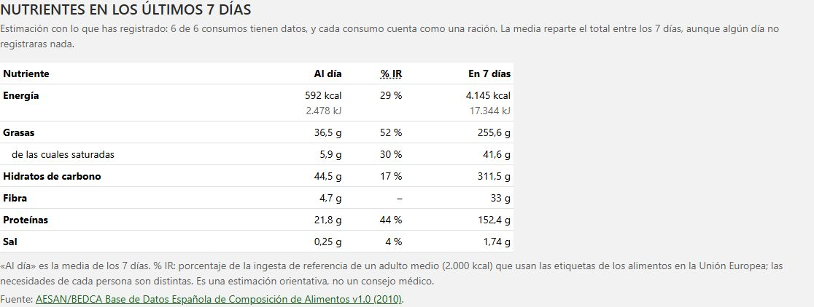

## 10. El histórico de lo que has comido

En **Mi alimentación → Ver histórico completo** aparecen todos tus consumos, del más reciente al más antiguo. Con el lápiz de cada uno puedes:
- **cambiar la fecha y la hora**: no puede ser futura;
- **eliminarlo**: la aplicación te pide confirmación.

Los cambios se notan al momento en «Mi alimentación» y en «¿Qué toca hoy?».

Si el autor de una receta que comiste la elimina, en el histórico aparece como **Eliminada**, sin foto ni enlace, y sigue contando en tus raciones.

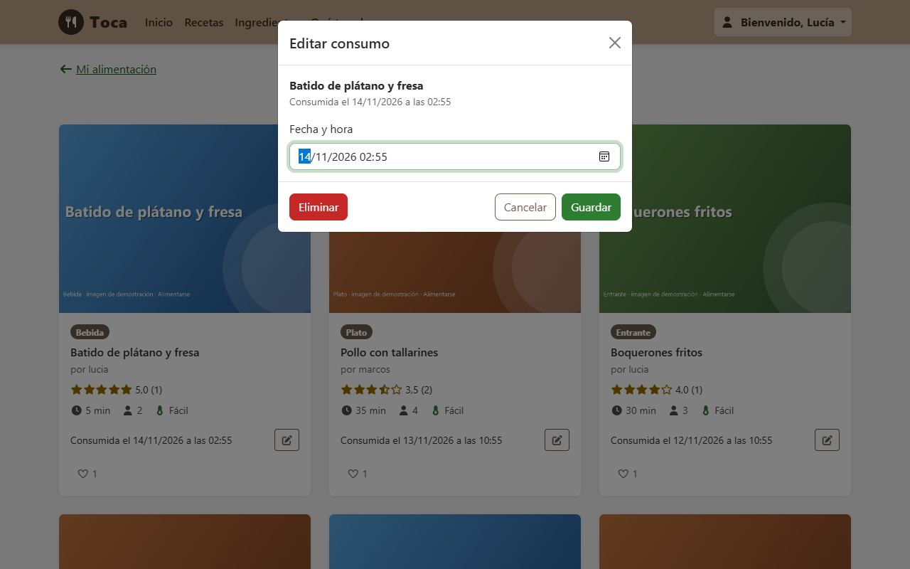

## 11. El planificador semanal

Está en el menú con tu nombre, en **Planificador**. Sirve para decidir de antemano qué vas a comer y ver cómo te quedaría la semana.

- Muestra **7 días a partir de hoy**, cada uno con su **comida** y su **cena**. Con **Siguiente** y **Anterior** cambias de semana.
- **Añadir** abre una ventana para elegir la receta: entre las que te recomendamos o buscándola por su título. Puedes tener hasta 200 comidas planificadas por llegar.
- Si una comida te haría pasar del máximo de algún grupo, verás en rojo **Te pasarías de: Carne (4/3)**. Se tiene en cuenta lo que ya has comido y lo que tienes planificado antes de esa comida, en los 7 días anteriores a ella.
- **Cómo quedarían tus raciones** muestra los círculos al terminar la semana que estás viendo.
- **Ya la he comido** la pasa a tu alimentación y la quita del planificador. **Quitar** solo la quita.

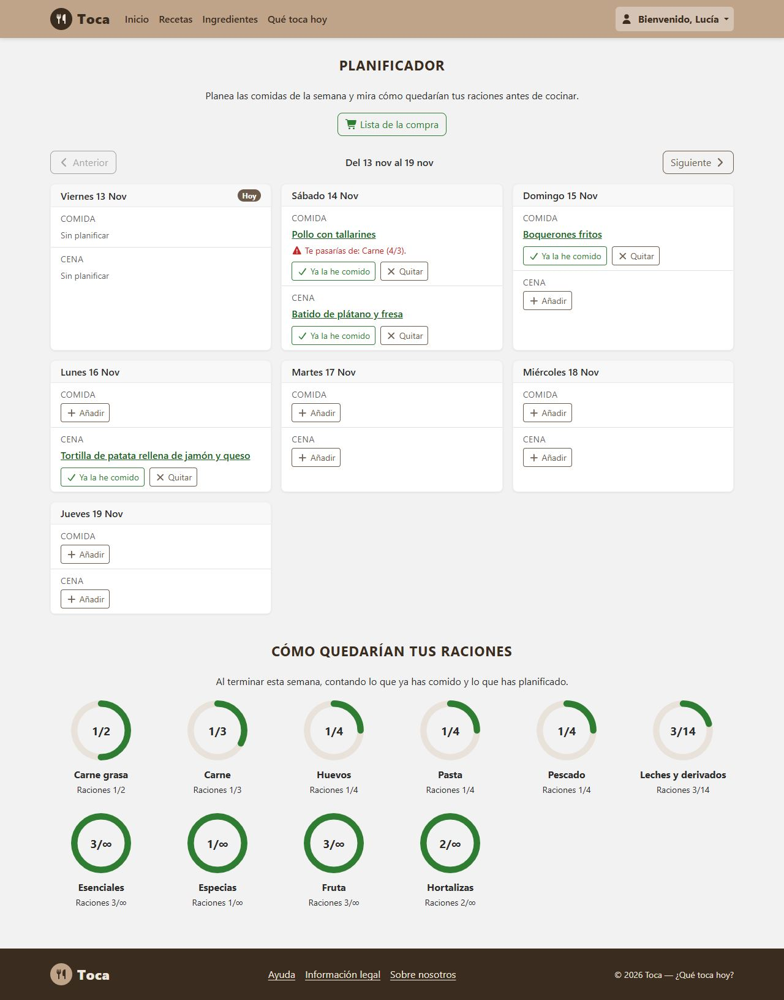

Lo planificado **no cuenta como comido** hasta que lo marcas o lo apuntas: no cambia «¿Qué toca hoy?» ni «Mi alimentación». Si el momento ya ha pasado y no lo marcaste, deja de contar también en el planificador.

Si el autor de una receta deja de publicarla o la elimina, seguirá en tu planificador con el aviso **Esta receta ya no está disponible**, y no contará. Puedes quitarla.

### La lista de la compra

El botón **Lista de la compra** del planificador reúne los ingredientes de las comidas que tienes planificadas en la semana que estás viendo y que aún no han pasado.

- Los ingredientes van **por grupo de alimentos**, como los pasillos de una tienda. Al final aparecen los que **suele haber en casa**: sal, aceite, especias…
- Si varias comidas llevan el mismo ingrediente, verás **cuánto hace falta en total** («Huevos – 13 unidades») y, debajo, lo que pide cada receta.
- Las cantidades solo se suman cuando están escritas de la misma manera: un número y la misma unidad («600 gramos» y «150 gramos»). Si no, como «1 pizca» y «al gusto», verás solo lo que pide cada receta.
- **Marca** lo que ya tienes o vas metiendo en el carro: queda tachado. Lo marcado se recuerda en ese navegador durante una semana. **Desmarcar todo** lo quita.
- **Imprimir o guardar en PDF** imprime la lista sin menú ni botones, a dos columnas y con una casilla junto a cada ingrediente.
- Al final, **Para estas comidas** dice de qué comidas sale la lista.

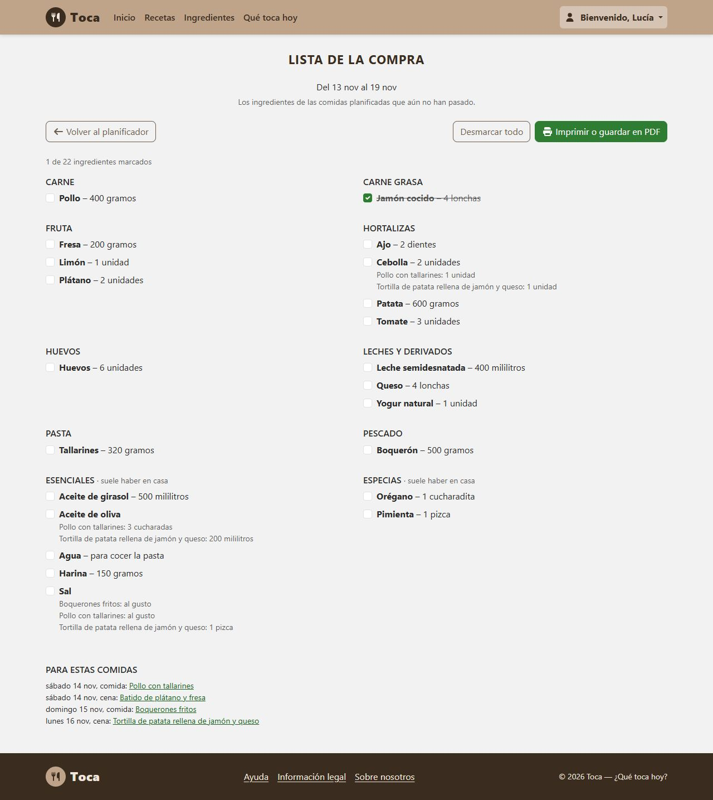

Si la abres con conexión antes de salir, podrás volver a verla en la tienda aunque no tengas cobertura (apartado 13).

### Recordatorios

Si activas los **avisos** en **Mi perfil** (apartado 12), Toca te avisa **una hora antes** de cada comida y cada cena que tengas en el planificador, como «Comida: Lentejas estofadas · Hoy a las 14:00». Al pulsar el aviso se abre la receta. Si la quitas del planificador o la marcas como comida antes, no te llega.

## 12. Mi perfil

En **Bienvenido, {tu nombre} → Mi perfil** puedes:
- **cambiar tus datos:** nombre, apellidos y email. El nombre de usuario no se puede cambiar. Para cambiar el email te pide tu **contraseña actual** y te enviamos un enlace al **email nuevo**: hasta que lo abras, tu cuenta sigue con el anterior (bajo el campo verás «Cambio pendiente», con **Reenviar el enlace** y **Cancelar el cambio**). Al confirmarlo, te avisamos en el email anterior y se cierran tus sesiones abiertas en otros dispositivos: en el navegador en el que lo confirmes, si ya habías entrado, sigues dentro;
- **cambiar la contraseña:** escribe la actual y la nueva dos veces. Si creaste la cuenta con Google, no tienes una contraseña que sepas: pulsa **Enviarme el enlace** y elige una con el enlace que te llega al email. La necesitas para cambiarla desde aquí y para eliminar la cuenta;
- **Google:** si tu cuenta está vinculada con Google, tus datos lo indican. Con **Desvincular Google** (te pide la contraseña) dejas de entrar con Google; puedes volver a vincularla cuando quieras entrando con Google;
- **avisos:** activa **Recordarme la comida y la cena del planificador** para recibir los recordatorios (apartado 11) en este navegador. La primera vez, el navegador te pide permiso. **Enviar un aviso de prueba** comprueba que llegan. Se activan en cada navegador por separado (hasta 10): en el móvil y en el ordenador, en los dos. Al cerrar sesión se desactivan en ese navegador;
- **descargar tus datos:** un fichero con tu perfil, tus recetas, lo que has comido, tus «me gusta», tu planificador, tus valoraciones y en qué navegadores tienes los avisos;
- **eliminar tu cuenta:** te pide la contraseña para confirmarlo. Se borran tus datos, tus recetas (con sus fotos), tus consumos, tus «me gusta», tus valoraciones y tus avisos, y recibes un correo de confirmación. No se puede deshacer. Si alguien había comido alguna de tus recetas, en su histórico se conservan solo el título y los ingredientes, sin tu nombre.

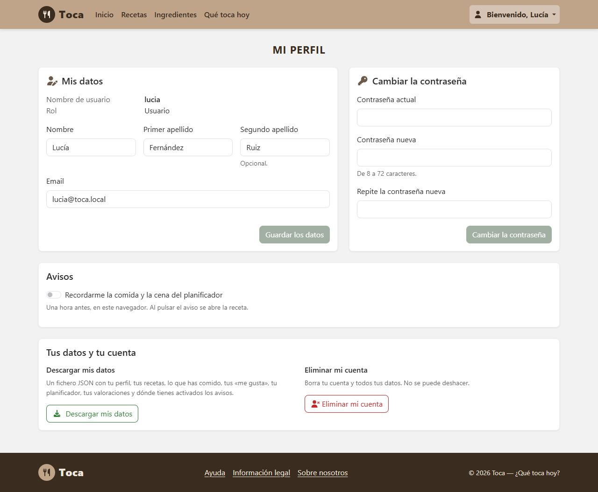

## 13. Toca en el móvil y sin conexión

Toca se adapta a la pantalla del móvil: el menú se abre con el botón ☰ y las tarjetas se ponen en una columna.

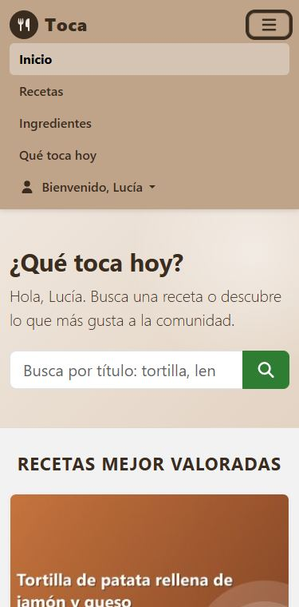

**Instalarla como aplicación.** En el móvil o en el ordenador, el navegador ofrece **Instalar Toca** o **Añadir a la pantalla de inicio**. Así se abre como una aplicación más, con su propio icono.

**Sin conexión.**
- Puedes seguir consultando lo que ya habías visto: recetas, ingredientes, «Mi alimentación»…
- Un aviso amarillo lo indica, y los botones que guardan cambios se deshabilitan.
- Cuando vuelve la conexión, un aviso te lo dice y todo funciona de nuevo.

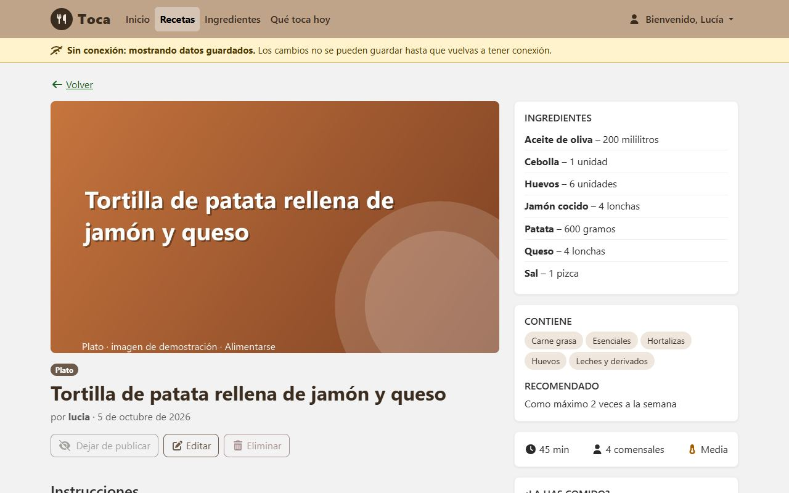

**Versión nueva.** Cuando se publica una versión nueva de Toca, aparece un aviso con el botón **Recargar**.

## 14. Administración

Los administradores ven en la barra el menú **Administrador**.

> **La primera cuenta de administrador** (`admin`) se crea al arrancar la aplicación por primera vez, con la contraseña que configuró quien la instaló. Después, cualquier administrador puede nombrar a otros.

**Gestión de usuarios** (**Administrador → Usuarios**):
- **Buscar:** por nombre de usuario, nombre, apellidos o email.
- **Dar o quitar el rol:** con el botón de la columna **Administrador**. Está resaltado si la persona ya es administradora.
- Al cambiarle el rol, esa persona **tendrá que volver a iniciar sesión**.
- No puedes quitarte el rol a ti mismo; tu fila lleva la marca «Tú». Además, siempre tiene que quedar al menos un administrador.
- Si otro administrador te cambia el rol, tu sesión se cierra y tienes que volver a entrar.
- **Bloquear a un usuario:** con el botón de la columna **Bloqueado** (en el móvil, «Bloq.»). Desde ese momento no puede entrar, y si tenía la sesión abierta, se le cierra. Sus recetas y sus datos no cambian; desbloquéalo con el mismo botón, y tendrá que volver a iniciar sesión. No puedes bloquearte a ti mismo ni bloquear a otro administrador (quítale antes el rol).

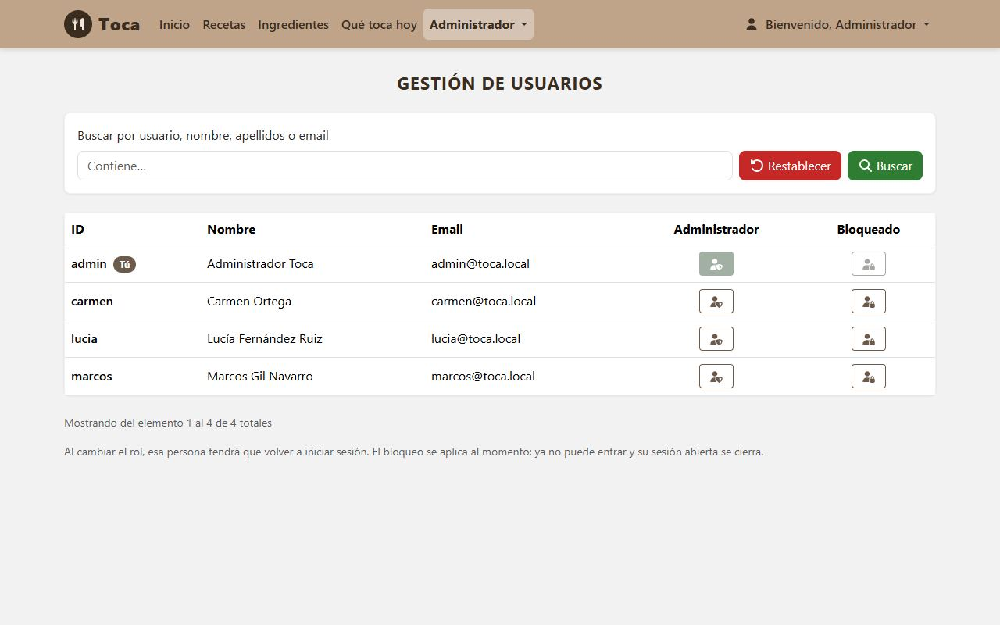

**Ocultar una receta.** Si una receta publicada no es adecuada, ábrela y pulsa **Ocultar (moderación)**. Escribe el motivo, que verá su autor. Desde ese momento solo la ven su autor y los administradores, y el autor no puede volver a publicarla. Las recetas ocultas están en **Administrador → Recetas ocultas**; ábrela y pulsa **Volver a mostrar** cuando esté resuelto.

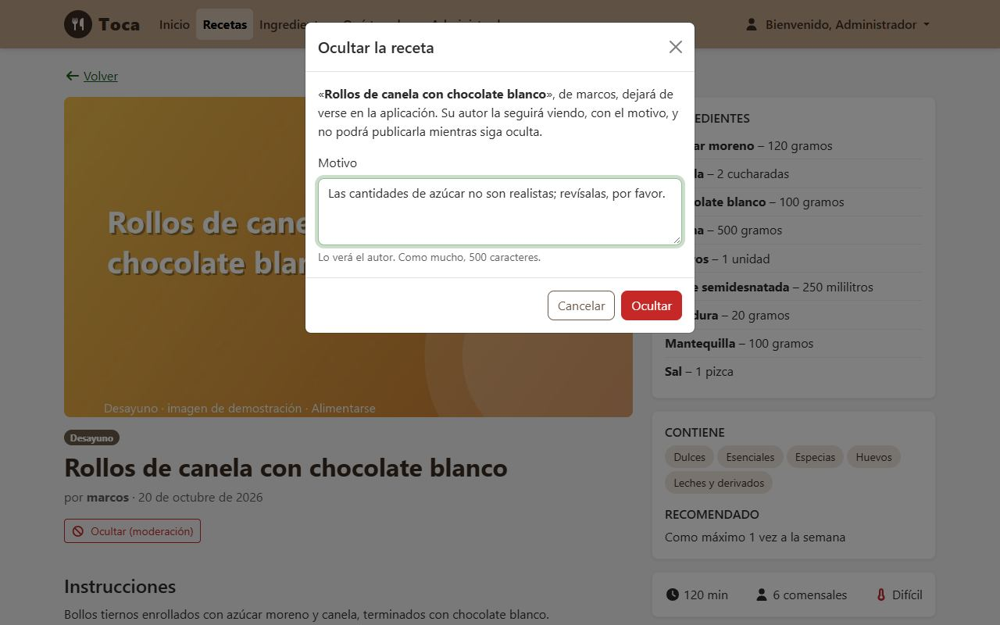

**Ocultar una valoración.** Si un comentario no es adecuado, en la receta pulsa **Ocultar** junto a esa valoración. Deja de verse y de contar en la nota media; los administradores la siguen viendo, marcada como **Oculta por la administración**, con el botón **Mostrar** para devolverla. Su autor ve un aviso en su valoración: puede borrarla, pero cambiarla no la vuelve a mostrar.

**Editar ingredientes.** En **Ingredientes**, los administradores ven cuatro botones en cada tarjeta:
- **el lápiz**, para cambiar el nombre o el grupo. Si cambias el grupo, cambian las recomendaciones de todas las recetas que lo llevan;
- **fusionar**, para los duplicados («Tomate» y «Tomates»). Elige el ingrediente bueno: las recetas que llevaban el duplicado pasan a llevar el bueno, y el duplicado se borra. Si una receta llevaba los dos, se suman sus cantidades. Si son de grupos distintos, la aplicación te avisa antes;
- **la papelera**, para borrar un ingrediente que no usa ninguna receta (por ejemplo, uno mal escrito).
- **la manzana**, los **datos nutricionales** (más abajo).

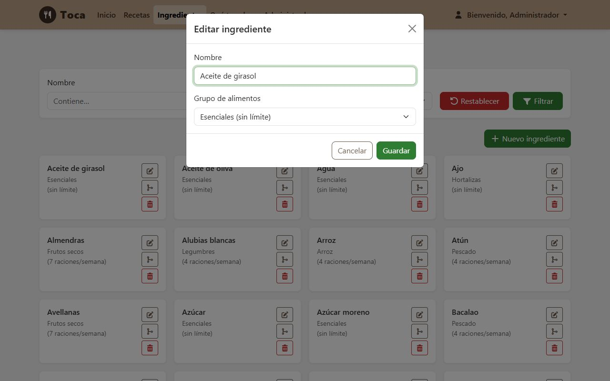

**Datos nutricionales de un ingrediente.** La información nutricional de las recetas usa, para cada ingrediente, un alimento de la Base de Datos Española de Composición de Alimentos (BEDCA). Los ingredientes nuevos no tienen ninguno, y no cuentan hasta que se lo asignas:
- marca **Solo los que no tienen datos nutricionales** en los filtros para ver cuáles faltan;
- pulsa la **manzana** del ingrediente y busca el alimento por palabras, en cualquier orden («pollo crudo»). Elige el más parecido, y crudo si lo hay: debajo verás sus valores por 100 g. **Quitar** deja el ingrediente sin alimento;
- en **Peso de las piezas**, añade las piezas en las que se suele contar («unidad», «diente», «lata»), con lo que pesa cada una en gramos de parte comestible. Así cuentan cantidades como «2 unidades» o «una lata». Las unidades de peso y volumen y las cucharadas ya se convierten solas;
- **Guardar** guarda el alimento y las piezas a la vez.

Al fusionar dos ingredientes, el que queda se lleva el alimento del duplicado si no tenía uno, y las piezas que no tuviera.

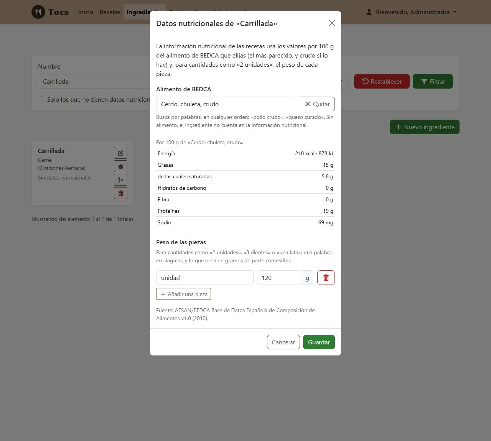

**Grupos de alimentos** (**Administrador → Grupos de alimentos**). Aquí están los grupos con sus raciones por semana, si son básicos y cuántos ingredientes tienen.
- **Nuevo grupo** o el lápiz de cada uno: nombre, raciones por semana como máximo (o **Sin límite semanal**) y si es **básico**. Los grupos básicos, como la sal o el aceite, no salen en «Ingredientes más usados».
- Cambiar las raciones de un grupo afecta al momento a los círculos de «Mi alimentación» y a «¿Qué toca hoy?» de todos los usuarios, también sobre lo que ya han comido esta semana.
- Solo se puede borrar un grupo que no tiene ingredientes.

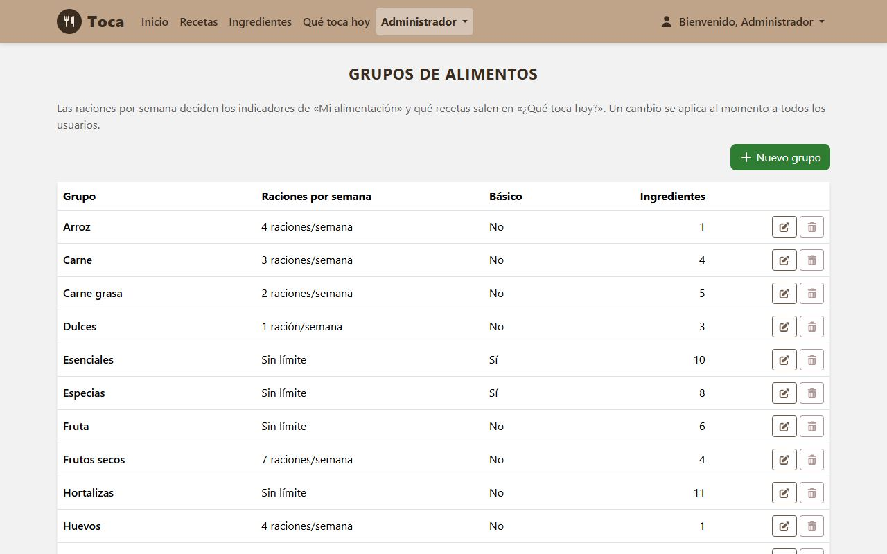

## 15. Preguntas frecuentes

**¿Por qué una receta no aparece en «¿Qué toca hoy?»?**
Lleva algún ingrediente de un grupo que ya has completado esta semana: el aviso de arriba dice cuáles. También puede ser que no esté publicada o que no cumpla los filtros.

**He apuntado un consumo con la fecha equivocada.**
Corrígelo en el histórico (apartado 10).

**Me sale «Demasiados intentos».**
Por seguridad, el inicio de sesión admite 10 intentos por minuto y la recuperación de contraseña, 5 cada 15 minutos. Espera un poco y vuelve a intentarlo.

**Al entrar me dice que mi cuenta está bloqueada.**
La administración ha bloqueado tu cuenta. Ponte en contacto con ella si crees que es un error.

**No me llega el correo para recuperar la contraseña.**
Revisa la carpeta de correo no deseado y comprueba que el email es el de tu cuenta. El enlace caduca en una hora: si ha pasado más tiempo, pide otro.

**¿Por qué en la lista de la compra no se suman algunas cantidades?**
Las cantidades las escribe el autor de cada receta, a su manera. Solo se suman si empiezan por un número y llevan la misma unidad: «200 gramos» y «1 kg», o «1 pizca» y «al gusto», no se pueden sumar, y la lista te enseña lo que pide cada receta.

**No me llegan los avisos.**
- En **Mi perfil**, comprueba que **Recordarme la comida y la cena del planificador** está activado en ese navegador y pulsa **Enviar un aviso de prueba**.
- Si dice que has bloqueado las notificaciones, permítelas en la configuración del sitio del navegador.
- En el iPhone y el iPad, los avisos solo funcionan con Toca instalada en la pantalla de inicio (apartado 13).
- Si el aviso de prueba llega pero los recordatorios no, comprueba que la comida está en el planificador y que aún falta para ella: el aviso llega una hora antes.

**¿Se puede usar con el teclado o con un lector de pantalla?**
Sí:
- La primera pulsación de **Tab** muestra **Saltar al contenido**, que lleva directamente al contenido de la pantalla, sin pasar por el menú.
- Al cambiar de pantalla, el foco pasa a su título, así que el lector de pantalla anuncia dónde estás.
- Las ventanas emergentes se cierran con **Escape** y devuelven el foco al botón desde el que se abrieron.
- Los avisos, como «Añadida a tus consumos», se anuncian sin mover el foco.
- En el planificador, al añadir, quitar o marcar una comida, el foco se queda en ese hueco del día.
- Los botones de las tarjetas y del planificador dicen a qué receta se refieren, por ejemplo «Quitar Tortilla de patata del planificador».
- Se ha probado con el lector de pantalla NVDA y Edge.

**¿Quién ve mis recetas y lo que como?**
- Tus recetas las ve todo el mundo solo cuando las publicas.
- Lo que comes solo lo ves tú.
- Puedes descargar todos tus datos o eliminar tu cuenta desde **Mi perfil**.

Más detalles en **Información legal**, en el pie de la página.
